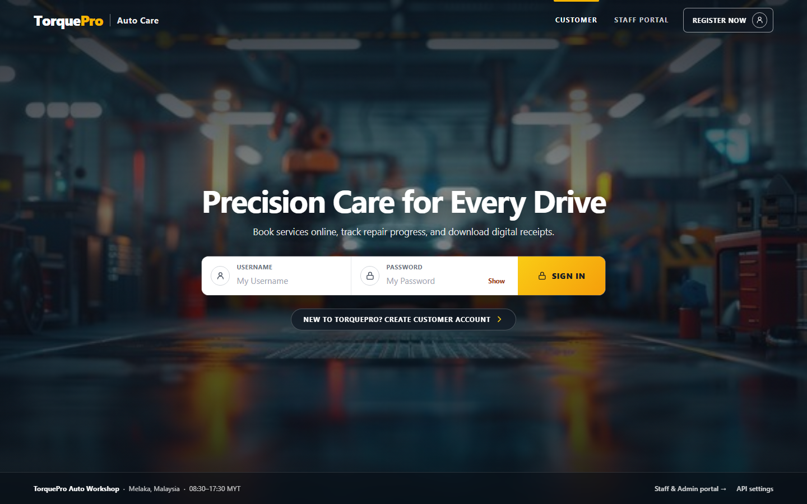
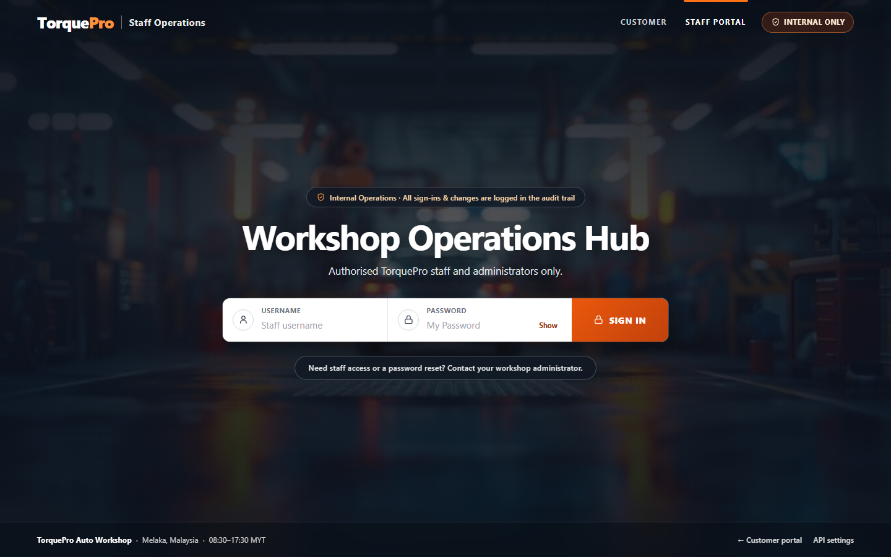
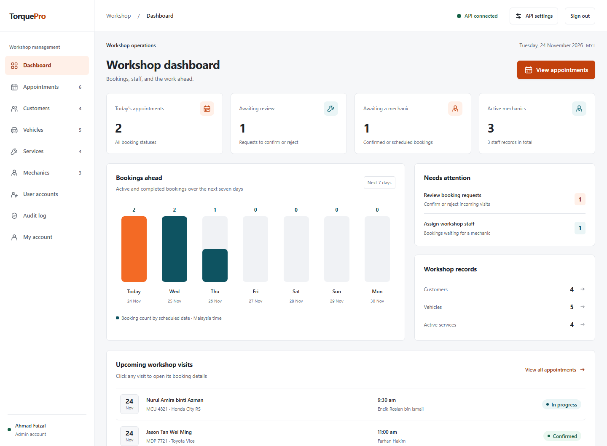
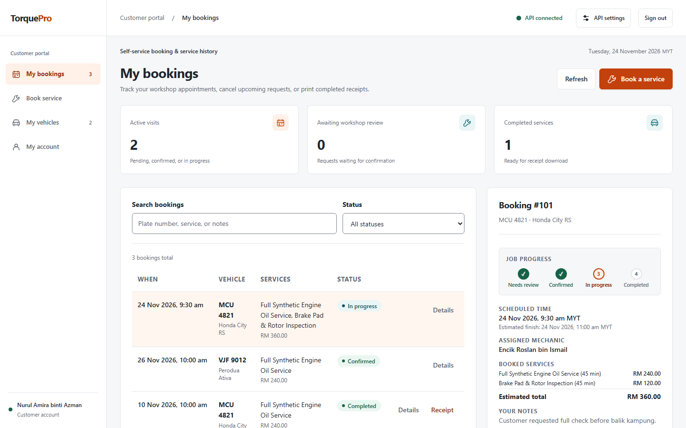
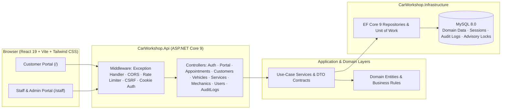

# TorquePro — Car Workshop Management System & Customer Portal

A full-stack, enterprise-style workshop operations platform and customer self-booking portal built with **ASP.NET Core 9**, **React 19**, **Tailwind CSS 4**, **Entity Framework Core**, and **MySQL 8**.

Designed around **Clean / Layered Architecture**, **3-role RBAC across dual portals**, **concurrency-safe mechanic & capacity scheduling**, and an **append-only admin audit trail**, with automated unit, real-MySQL integration, and frontend test suites wired into GitHub Actions CI.


---

## Interface Showcase

<table>
  <tr>
    <td width="50%">
      <strong>Customer Portal Sign In (<code>/</code>)</strong><br />
      
    </td>
    <td width="50%">
      <strong>Staff &amp; Admin Operations Sign In (<code>/staff</code>)</strong><br />
      
    </td>
  </tr>
  <tr>
    <td width="50%">
      <strong>Workshop Operations Dashboard</strong><br />
      
    </td>
    <td width="50%">
      <strong>Customer Self-Booking &amp; Tracking Portal</strong><br />
      
    </td>
  </tr>
</table>

---

## Key Engineering Highlights

* **Clean / Layered Architecture**: Strict separation across `Domain`, `Application`, `Infrastructure`, `Api`, and `Web` using repository interfaces, domain entity invariants, and Unit of Work persistence.
* **Dual-Portal Enterprise Authentication & Anti-IDOR**:
  * Separated public **Customer Portal (`/`)** and restricted **Staff & Admin Portal (`/staff`)** with role-scoped login endpoints (`/api/auth/customer/login` and `/api/auth/staff/login`).
  * Server-side customer ownership resolution on every `/api/portal/*` call prevents Insecure Direct Object Reference (IDOR) across customer records.
* **Defense-in-Depth Security**:
  * `HttpOnly`, `SameSite=Strict` cookie sessions backed by server-side `WorkshopSessions` revocation (8-hour fixed lifetime, zero credentials in `localStorage`/`sessionStorage`).
  * Per-request CSRF validation (`X-CSRF-TOKEN`), constant-time dummy password verification (mitigates timing-based username enumeration), row-level `SELECT ... FOR UPDATE` lockout protection (5 failed attempts → 15-minute lock), and per-IP fixed-window rate limiting (60 req/min).
* **Concurrency-Safe Workshop Scheduling & Live Slot Availability**:
  * Shared MySQL advisory locks serialize booking creation, rescheduling, mechanic assignments, and stock adjustments to prevent overlapping mechanic jobs, overlapping vehicle bookings, and overbooking beyond active-mechanic slot capacity and daily caps.
  * Live availability API (`GET /api/portal/availability` and `GET /api/appointments/availability`) powers the interactive 30-minute MYT slot picker (`08:30–17:30`) across both portals, highlighting remaining bays and exact conflict reasons (`Full`, `Vehicle busy`, `Past 5:30 PM`, `Day full`).
* **Spare Parts Inventory, Invoicing & Payment Tracking**:
  * Full parts catalogue (`/api/parts`) with uppercase SKU normalization, unit pricing, manual stock adjustments (`+` / `-` with audit trail), and automatic low-stock threshold alerts.
  * Adding or removing spare parts on `InProgress` / `Completed` appointments snapshots SKU, name, and unit price while atomically deducting or restoring inventory stock.
  * Completing a job automatically issues an itemized invoice (`INV-YYYY-00001`) combining Labour + Spare Parts, supports partial and full counter payment recording (`Cash`, `DuitNow QR`, `Card`, `Online Transfer`), locks part modifications after payment, feeds live Dashboard revenue/outstanding/low-stock summaries, and renders printable PDF invoices/receipts.
* **Production Hardening & End-to-End Audit Trail**:
  * Security response headers (`X-Content-Type-Options`, `X-Frame-Options`, `Referrer-Policy`, `Permissions-Policy`), per-request `X-Request-Id` correlation logging, reverse-proxy `ForwardedHeaders` support, persistent Data Protection keys (`WORKSHOP_DATA_PROTECTION_KEYS_PATH`), readiness probe (`GET /api/health/ready`), and `--migrate` CLI command.
  * Append-only **Admin Audit Log** recording workshop mutations, status changes, part usage, invoice issuance, payment records, failed sign-ins, and cross-portal access denials with before/after JSON diff snapshots and pagination.
* **Automated Quality Gates**:
  * Domain unit tests (`xUnit`), real MySQL 8 integration tests (`WebApplicationFactory` + isolated temporary schemas), Node frontend tests, Playwright browser verification scripts, and GitHub Actions CI ([`.github/workflows/ci.yml`](.github/workflows/ci.yml)).

---

## System Architecture



---

## Role & Capability Matrix

| Module / Action | Customer (`/`) | Staff (`/staff`) | Admin (`/staff`) |
| --- | :---: | :---: | :---: |
| Self-registration & profile management | Own profile | — | — |
| Vehicle registration, edit & service history | Own vehicles | All vehicles (incl. ownership transfer) | All vehicles |
| Service catalogue management | Browse active | Create, edit & activate/deactivate | Create, edit & activate/deactivate |
| Appointment booking, live slot picker & 1-click status workflow | Pick live slots, book & cancel own | Live slots, full lifecycle & conflict checks | Live slots, full lifecycle & conflict checks |
| Mechanic management & job assignment | View assigned | Manage mechanics & assign jobs | Manage mechanics & assign jobs |
| Spare parts inventory & job part usage | View parts used on own jobs | Full inventory, stock adjust & job parts | Full inventory, stock adjust & job parts |
| Invoicing, payment recording & printable PDF invoice | View own invoice & print receipt | Auto-invoice, record payments & print | Auto-invoice, record payments & print |
| Service record & odometer logging | View history | Record completed work & mileage | Record completed work & mileage |
| Staff/Admin user accounts & password resets | — | Change own password | Full account & reset management |
| Append-only Audit Log with diff viewer | — | — | Search, filter & inspect |

See [AUTHENTICATION.md](AUTHENTICATION.md) for the complete security architecture, session revocation rules, and production deployment checklist.

---

## Tech Stack

| Layer | Technology |
| --- | --- |
| **Frontend** | React 19, Vite 8, Tailwind CSS 4, Native `node:test` |
| **Backend API** | C# / .NET 9, ASP.NET Core Web API, OpenAPI |
| **Data & ORM** | Entity Framework Core 9, Pomelo MySQL Provider, MySQL 8.0 |
| **Security** | ASP.NET Core Cookie Auth, Data Protection, Identity `PasswordHasher`, Antiforgery (CSRF), Rate Limiting |
| **Testing & CI** | xUnit, Real MySQL Integration Tests, Playwright E2E Scripts, GitHub Actions |

---

## Project Structure

```text
├── .github/workflows/ci.yml        # Automated CI: backend build, unit + MySQL integration tests, frontend tests & build
├── docs/screenshots/               # Showcase screenshots
├── scripts/                        # Verification & Playwright browser E2E scripts
├── src/
│   ├── CarWorkshop.Domain/         # Core entities, value invariants, and domain rules
│   ├── CarWorkshop.Application/    # Use-case services, DTO contracts, and repository interfaces
│   ├── CarWorkshop.Infrastructure/ # EF Core DbContext, entity configurations, migrations, MySQL repositories
│   ├── CarWorkshop.Api/            # HTTP controllers, auth/CSRF middleware, validation, DI wiring
│   └── CarWorkshop.Web/            # React 19 SPA (Customer Portal, Staff & Admin Portal, Tailwind UI)
└── tests/
    ├── CarWorkshop.UnitTests/      # Domain & business rule unit tests
    └── CarWorkshop.IntegrationTests/ # End-to-end API + real MySQL concurrency & security tests
```

---

## API Overview

| Domain | Endpoints |
| --- | --- |
| **Authentication** | `GET /api/auth/csrf`, `GET /api/auth/me`, `POST /api/auth/register`, `POST /api/auth/customer/login`, `POST /api/auth/staff/login`, `POST /api/auth/logout`, `POST /api/auth/change-password` |
| **Customer Portal** | `GET/PUT /api/portal/profile`, `GET /api/portal/services`, `GET /api/portal/availability`, `GET/POST/PUT/DELETE /api/portal/vehicles`, `GET/POST /api/portal/appointments`, `POST /api/portal/appointments/{id}/cancel`, `POST /api/portal/appointments/{id}/receipt-printed` |
| **Workshop Operations** | `/api/customers`, `/api/customers/{id}/vehicles`, `/api/vehicles`, `/api/services`, `/api/parts`, `POST /api/parts/{id}/adjust-stock`, `/api/mechanics`, `/api/appointments`, `GET /api/appointments/availability`, `POST /api/appointments/{id}/status`, `PUT /api/appointments/{id}/mechanic`, `POST /api/appointments/{id}/service-record`, `POST/DELETE /api/appointments/{id}/parts`, `POST /api/appointments/{id}/payment`, `POST /api/appointments/{id}/receipt-printed` |
| **Administration & Ops** | `GET/POST/PUT /api/users`, `POST /api/users/{id}/reset-password`, `GET /api/audit-logs`, `GET /api/health`, `GET /api/health/ready` |

---

## Getting Started (Local Development)

### Prerequisites

* [.NET 9 SDK](https://dotnet.microsoft.com/download/dotnet/9.0)
* [Node.js 22+](https://nodejs.org/) (CI uses Node 24)
* [MySQL 8.0](https://dev.mysql.com/downloads/mysql/)

### 1. Configure Database Connection

Store your MySQL connection string in .NET User Secrets (never commit credentials into `appsettings.json`):

```powershell
dotnet user-secrets set "ConnectionStrings:DefaultConnection" "Server=127.0.0.1;Port=3306;Database=car_workshop;User ID=root;Password=YOUR_PASSWORD;" --project src/CarWorkshop.Api
```

### 2. Apply Migrations & Bootstrap the First Admin

```powershell
# Apply EF Core migrations
dotnet ef database update --project src/CarWorkshop.Infrastructure --startup-project src/CarWorkshop.Api

# One-time interactive Admin bootstrap (creates first Admin only when no accounts exist)
$env:WORKSHOP_ADMIN_USERNAME = Read-Host 'Administrator username'
$secret = Read-Host 'Administrator password (12 to 128 characters)' -AsSecureString
$env:WORKSHOP_ADMIN_PASSWORD = [Net.NetworkCredential]::new('', $secret).Password
try {
    dotnet run --project src/CarWorkshop.Api/CarWorkshop.Api.csproj --launch-profile http -- --bootstrap-admin
} finally {
    Remove-Item Env:WORKSHOP_ADMIN_USERNAME, Env:WORKSHOP_ADMIN_PASSWORD -ErrorAction SilentlyContinue
    $secret = $null
}
```

### 3. Run API & Frontend

Open two terminals from the repository root:

```powershell
# Terminal 1 — ASP.NET Core API (http://127.0.0.1:5272)
dotnet run --project src/CarWorkshop.Api/CarWorkshop.Api.csproj --launch-profile http
```

```powershell
# Terminal 2 — React + Vite Frontend (http://127.0.0.1:4173)
Set-Location src/CarWorkshop.Web
npm ci
npm run dev
```

* **Customer Portal**: `http://127.0.0.1:4173/`
* **Staff & Admin Portal**: `http://127.0.0.1:4173/staff`

> Vite automatically proxies `/api` requests to `http://127.0.0.1:5272` in local development. Set `VITE_API_BASE_URL` in `src/CarWorkshop.Web/.env.local` only when targeting a separately hosted API.

---

## Running Tests & Verification

```powershell
# Backend domain & business rule unit tests
dotnet test tests/CarWorkshop.UnitTests/CarWorkshop.UnitTests.csproj -m:1

# Frontend unit tests & production build
Set-Location src/CarWorkshop.Web
npm test
npm run build
```

For real-MySQL API integration tests and Playwright E2E scenarios, see [`tests/CarWorkshop.IntegrationTests/README.md`](tests/CarWorkshop.IntegrationTests/README.md) and [`AUTHENTICATION.md`](AUTHENTICATION.md).
